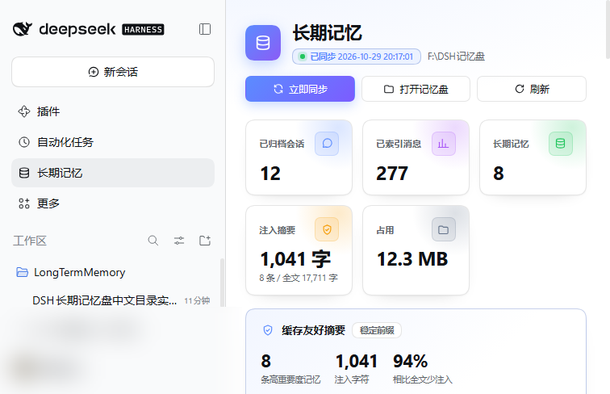
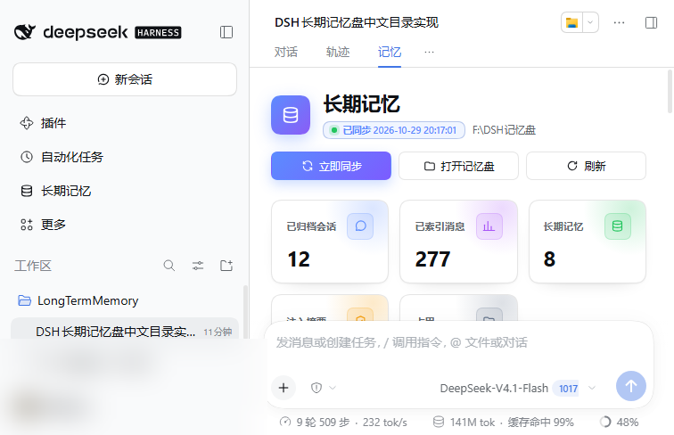
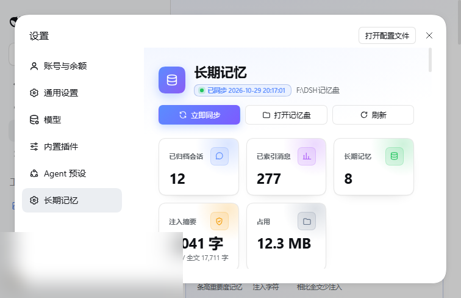

# dsh-memory-disk

DeepSeek Harness 插件：把一套本地长期记忆盘接入 DSH 的会话与设置界面。

仓库：<https://github.com/mesong00/dsh-memory-disk>

- 记忆盘根目录：**首次运行选择**（旧机器若已有 `F:\DSH记忆盘` 会自动沿用，也可用 `DSH_MEMORY_ROOT` 覆盖）
- 数据格式：Markdown 归档 + SQLite FTS5
- 版本：**0.5.0**（自带引擎、首次运行向导、记忆移植、重要度/删除、稳定摘要、视觉改版）

## 能力与入口

1. **系统提示注入**：每个会话自动出现约 500 字的“长期记忆盘”规则 + 高重要度摘要；
2. **`memory_search` 工具**：模型可直接检索历史对话和长期记忆；
3. **左侧边栏「长期记忆」**：与“插件 / 自动化任务 / 上下文洞察”同级的独立页面；
4. **会话顶部「记忆」标签**：在“对话 / 轨迹 / 上下文 / 编队”旁边，点开即是记忆面板；
5. **设置页「长期记忆」**：同一套面板的第三个入口；
6. **首次运行向导**：没有记忆盘时让用户选目录，自动创建 00/01/02/03/04 并同步；
7. **记忆移植**：导出 zip，换电脑后导入并合并，冲突的旧文件备份到 `_回收站`。

面板内容：5 个 KPI（会话/消息/记忆/注入摘要/占用）、缓存摘要卡、中文检索、立即同步、打开记忆盘、刷新、记忆构成、项目分布、最近会话、最近长期记忆、记忆管理、记忆移植。





## 安装（桌面版）

开发目录安装：

```powershell
$dsh = "F:\DSH\resources\runtime\cli\bin\dsh.cmd"
& $dsh plugin --profile desktop add "<本仓库路径>"
```

发布到 npm 后可直接：

```powershell
& $dsh plugin --profile desktop add dsh-memory-disk
```

从 GitHub 安装（pnpm 支持 git 依赖）：

```powershell
& $dsh plugin --profile desktop add "https://github.com/mesong00/dsh-memory-disk.git"
```

> 发行版前置条件：Python 3.10+、`zstandard`（`python -m pip install zstandard`）。
> 记忆引擎已内置在 `server/`，不需要额外安装 F 盘的脚本；首次运行在界面里选目录即可。
> 旧机器的 `F:\DSH记忆盘` 若存在会自动沿用，不需要重新配置。

装完**退出 DSH Desktop（托盘退出，不是关窗口）再重新打开**。重启后：

- 左侧边栏出现「长期记忆」；
- 每个会话顶部出现「记忆」标签；
- 设置（侧边栏账号菜单 → 设置，或 `Ctrl+Alt+,`）→ 左侧也有「长期记忆」。

首次打开如果没有配置记忆盘，会显示「选择记忆盘目录」向导；选目录后自动创建结构并同步。

## 记忆移植

- 面板底部「记忆移植」→ **导出记忆包**：生成 `04_整理记录/迁移/记忆包_<时间>.zip`，包含 `00_说明`、`01_对话归档`、`02_长期记忆`、`03_索引`；
- 新电脑安装插件后 → **导入记忆包**：合并导入，同名记忆冲突时把旧文件移到 `02_长期记忆/_回收站/导入冲突_<时间>/`；
- 超大包（>800 MB）建议用命令行：
  ```powershell
  python "<插件目录>\server\迁移记忆.py" export --to D:\记忆包.zip
  python "<插件目录>\server\迁移记忆.py" import --from D:\记忆包.zip --mode merge
  ```



卸载：

```powershell
& $dsh plugin --profile desktop remove dsh-memory-disk
```

## 结构

```text
dsh-memory-plugin/
├── index.js            # Host 半：提示注入 + memory_search + /api/dsh-memory/* 路由
├── lib/client.js       # 浏览器半：lazy-CJS 工厂；侧边栏页面 + 会话标签 + 设置页
├── cordis.patch.yml    # bundle 插入层
├── package.json        # exports["./client"] + dsh.client.platform = web
└── test/unit.mjs
```

### UI 入口

| 位置 | slot |
|---|---|
| 左侧边栏「长期记忆」 | `sidebar.panellist`（行）+ `main`（页面） |
| 会话顶部「记忆」 | `conversation.view` |
| 设置页「长期记忆」 | `settings.section` |

三处复用同一个 `MemorySection` 组件，数据都来自下面的 Host 路由。

### 记忆管理与缓存

- 「记忆管理」列出全部记忆，每条可设 **重要度 1-5**、点「删除」移到回收站；
- 未显式设置时的默认重要度：用户画像/偏好与约定 = 5，项目/经验 = 4，知识 = 3，事件 = 2；
- 设置重要度会写入该文件 frontmatter 的 `重要度`，之后以文件为准；
- 系统提示只注入**重要度最高的 8 条**的标题 + 一句摘要（当前约 1,000 字），不注入全文（约 17,000 字）；摘要不含时间戳，跨会话保持稳定，便于复用前缀缓存；需要细节时用 `memory_search`；
- 删除会移到 `02_长期记忆/_回收站/时间/原路径`，同时重建检索索引；可从回收站手动恢复。

### Host 路由

| 路由（POST） | 作用 |
|---|---|
| `/api/dsh-memory/status` | 统计、项目分布、最近会话/记忆、摘要字数 |
| `/api/dsh-memory/search` | `{query, limit}` → 对话/记忆片段 |
| `/api/dsh-memory/sync` | 立即跑一次同步，返回统计 |
| `/api/dsh-memory/open` | `{path}` 在资源管理器打开（限制在记忆盘内） |
| `/api/dsh-memory/memories` | 全部长期记忆（含重要度、字数、摘要） |
| `/api/dsh-memory/importance` | `{path, importance}` 设置重要度并写回 frontmatter |
| `/api/dsh-memory/delete` | `{path}` 移到 `_回收站` 并重建索引 |
| `/api/dsh-memory/brief` | 当前注入系统提示的摘要文本与统计（调试用） |

路由通过 `ctx.inject(['connection'])` → `connection.fetch.register({ path, methods:['POST'], requestBody:'buffered', fetch })` 注册，和 `dsh-context` 的插件路由同一套机制。

### 客户端打包

DSH 的 client module system 只接受 lazy-CJS 工厂产物：

```js
window.__ModuleLoader__.load({
  id: 'dsh-memory-disk',
  factory: (require) => {
    var module = { exports: {} }; var exports = module.exports
    var React = require('react')
    // ...
    exports.name = 'dsh-memory-disk'
    exports.inject = ['slots']
    exports.apply = (ctx) => { /* ctx.slots.register(...) */ }
    return module.exports
  },
})
```

本插件没有构建步骤：`lib/client.js` 手写、只 `require('react')`（平台已注入），CSS 由 `<style>` 标签注入，所以不需要 tsdown/Tailwind。

页面通过 `ctx.slots.register({ name:'settings.section', id:'dsh-memory-disk', order:40, label:()=> '长期记忆' }, MemorySection)` 注册；设置外壳会自动生成左侧导航行并渲染组件。

## 环境变量（可选）

| 变量 | 默认值 | 用途 |
|---|---|---|
| `DSH_MEMORY_ROOT` | `F:\DSH记忆盘` | 记忆盘根目录 |
| `DSH_MEMORY_PYTHON` | `D:\Python311\python.exe`，否则 `python` | 运行 Python 数据接口 |

## 开发验证

```powershell
node --check index.js
node --check lib/client.js
node test\unit.mjs
```

- `test\unit.mjs`：假 `ctx` 验证系统提示注册、工具注册、真实检索输出；
- 客户端注册冒烟：用假 `window.__ModuleLoader__` 装载 `lib/client.js`，假 `ctx.slots` 断言 `settings.section` 注册；
- SSR 冒烟：用 React `renderToString` 渲染设置页初始状态；
- 路由联调：把插件装进 `web` profile，`dsh web --port <port> --no-open`，带 `?token=` 的会话 POST 四个路由，已在 2026-10-29 实测 `status/search/sync` 返回 200。

## 注意

- 插件只读记忆盘（除「立即同步」会运行同步脚本）；写入仍由模型按记忆盘规范执行。
- 设置页数据每次打开/刷新时拉取；同步完成后自动刷新统计。
- 路由限制在 `DSH_MEMORY_ROOT` 内，`open` 无法打开记忆盘外的路径。
